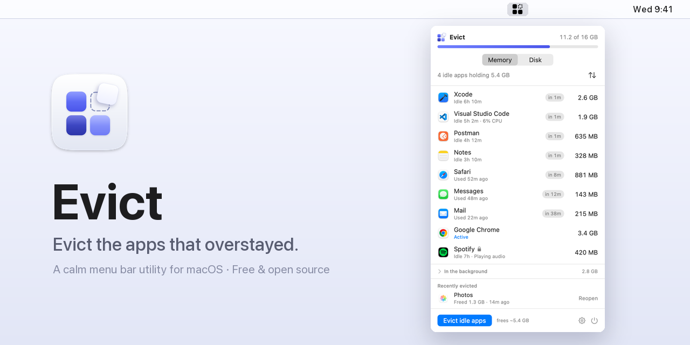
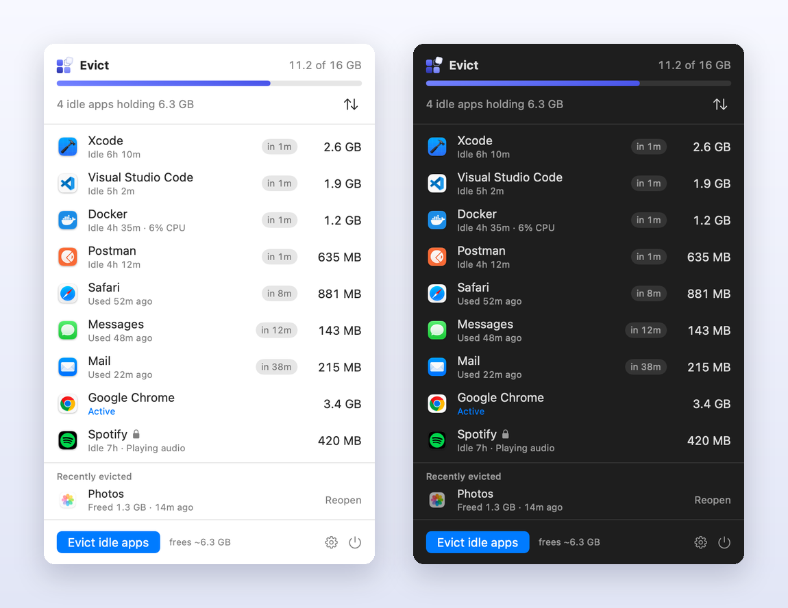
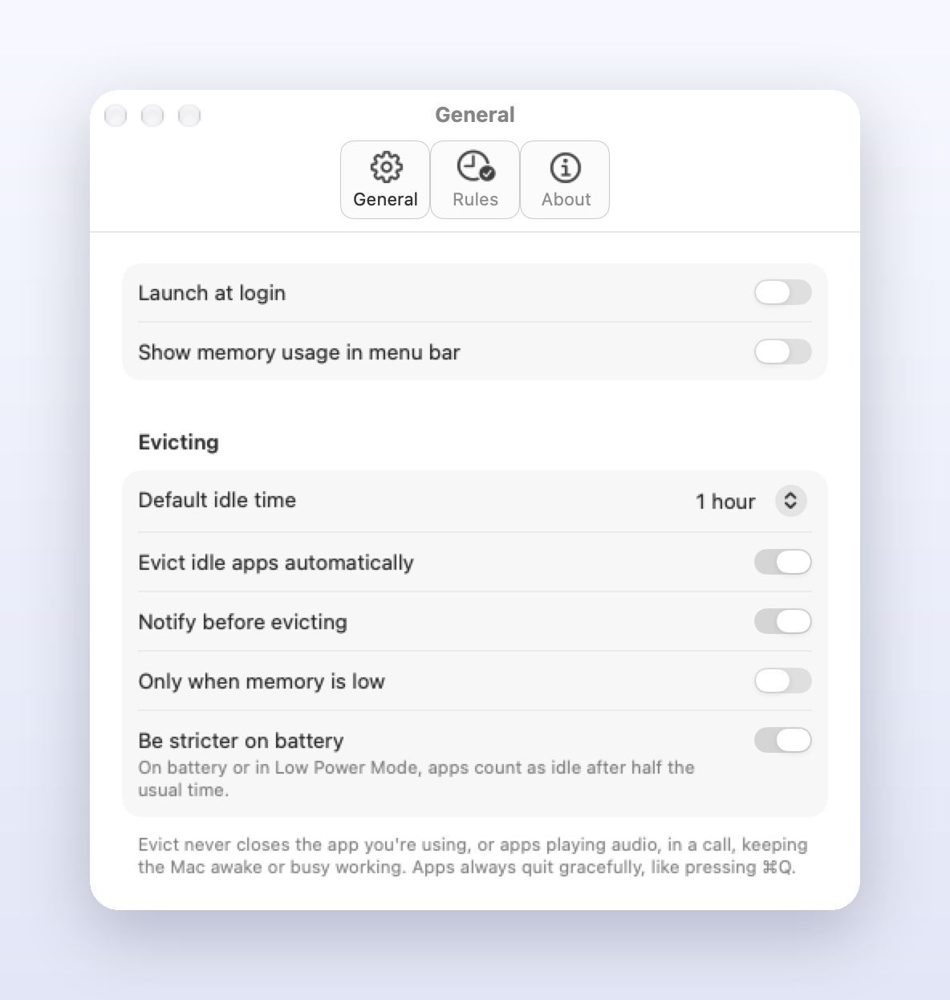

<p align="center">
  
</p>

Evict is a free, open-source menu bar utility for macOS. It answers one simple
question — *what's open, how much is it costing me, and how long since I last
used it?* — and can quietly close the apps that have been sitting idle for too long.

It informs; you decide. No scary warnings, no "optimization scores".

<p align="center">
  
</p>

## What it does

- **Shows what's open and what it costs.** Only the apps you opened (the ones in
  your Dock), with their real memory use — helper processes included, so Chrome,
  Slack or VS Code show their true total — and how long since you last used them.
- **One click to act.** Quit any app, or evict every idle app at once and see how
  much memory that frees. Protect the apps you always want running.
- **Evicts automatically, if you want.** Set a default idle time (and per-app
  rules, or "Never"). Before closing anything, Evict sends a notification with a
  **Keep Open** button. Optionally, only evict when memory is actually low.
- **Never interrupts.** Evict won't close the app you're using, or an app that's
  playing audio, on a call, keeping the Mac awake (downloads, exports, video) or
  busy working. Apps always quit gracefully, like pressing ⌘Q, so they can ask to
  save your work.
- **Shows what hides in the background.** Memory held outside the Dock — menu bar
  apps, helpers and agents like Docker's VM — grouped by app. Menu bar apps can be
  quit right from there.
- **Easy to undo.** Recently evicted apps are one click away from coming back.
- **Kind to your battery.** On battery or in Low Power Mode, apps count as idle
  after half the time, and apps burning CPU in the background are called out.
- **Stays out of the way.** Menu bar only, optional memory % next to the icon,
  launch at login. Light and dark mode, VoiceOver, Reduce Motion and Increase
  Contrast. English and Português (Brasil).

<p align="center">
  
</p>

## Install

With [Homebrew](https://brew.sh):

```sh
brew install --cask zaiinehaniel/tap/evict
```

Or by hand:

1. Download `Evict.zip` from the latest [release](../../releases/latest).
2. Unzip it and move `Evict.app` to `/Applications`.
3. Open it. Evict isn't notarized by Apple (it's a free project without a paid
   developer account), so macOS will block the first launch. To allow it:
   - open **System Settings → Privacy & Security**, scroll down and click
     **Open Anyway** next to the message about Evict, or
   - run `xattr -dr com.apple.quarantine /Applications/Evict.app` in Terminal.

Requires macOS 14 Sonoma or later (detecting apps playing audio or on a call needs
macOS 14.2+).

## Build from source

Requirements: Xcode 16+ and [XcodeGen](https://github.com/yonaskolb/XcodeGen).

```sh
brew install xcodegen
xcodegen generate
open Evict.xcodeproj
```

Or from the command line:

```sh
xcodebuild -project Evict.xcodeproj -scheme Evict -configuration Release -derivedDataPath build build
open build/Build/Products/Release/Evict.app
```

### Releasing

Push a version tag and GitHub Actions builds `Evict.zip`, attaches it to a new
release and updates the [Homebrew cask](https://github.com/zaiinehaniel/homebrew-tap):

```sh
git tag v0.1.0 && git push origin v0.1.0
```

### Developer tools (Debug builds only)

```sh
# What Evict sees right now: memory, idle time and busy state of every app
build/Build/Products/Debug/Evict.app/Contents/MacOS/Evict --dump-state

# Regenerate the README images from the real UI, with sample data
build/Build/Products/Debug/Evict.app/Contents/MacOS/Evict --render-screenshots "$PWD/docs/images" \
  -AppleLocale en_US -AppleLanguages "(en)" -AppleAccentColor 4
python3 design/brand/make_readme_images.py
```

Translations live in `Evict/Localizable.xcstrings`; the icon sources in `design/icon/`.

## Privacy

Evict never connects to the internet and collects no data. Everything it does
happens locally on your Mac — no analytics, no telemetry, no update checks.

## License

[MIT](LICENSE)
